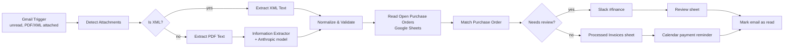

# Invoice–PO Matching for Spain and the EU (n8n)

An n8n workflow that reads supplier invoices from Gmail, checks them against Spanish invoicing rules and your open purchase orders, and sends each one down one of two paths:

- **OK:** the invoice is logged in Google Sheets and a payment reminder is added to Google Calendar on the due date.
- **Review:** a message goes to Slack with the exact reasons, and the invoice is logged in a Review sheet.

It handles structured e-invoices (**Facturae** XML and **UBL** XML) and plain **PDF** invoices. PDFs are read with an AI model (Claude, through n8n's Information Extractor). XML files are parsed directly, without AI.

> Built by Nathaly Muñoz G. as a practical accounts-payable automation. It is a starting point to adapt, not a certified tax tool.

**Status:** the workflow imports cleanly into n8n, and the validation and matching logic passes the tests in `tests/` with the sample invoices. A full end-to-end run with live Gmail, Sheets, Slack and Anthropic credentials is the next step.

## How it works



### What is checked

| Check | Rule |
|---|---|
| Supplier tax ID | Spanish NIF (DNI), NIE and CIF with their control character. EU VAT numbers are checked for format only, so confirm them in VIES. |
| Customer tax ID | The invoice must be addressed to your company's NIF. |
| Totals | Sum of tax bases + VAT + recargo de equivalencia − IRPF withholding = invoice total (±0.02 €). |
| VAT lines | Each line's VAT amount = base × rate (±0.02 €). Several VAT rates are supported and flagged as a note. |
| Dates | Issue date required. If there is no due date, it is set to issue date + 30 days and marked as estimated. |
| Purchase order | Found by the PO number on the invoice. If there is none, it uses the supplier's open PO, but only when there is exactly one. The amount must be within 1 % or 5 €, whichever is lower. |
| VERI\*FACTU | For PDFs, records whether a VERI\*FACTU QR/legend is visible. This is informational only and does not affect routing. |

Any failed check sends the invoice to review, together with every reason found.

## Setup

1. **Import** `invoice-po-matching-spain-eu.json` into n8n (*Workflows → Import from file*). Optionally import `error-alerts.json` and select it under *Workflow settings → Error workflow*.
2. **Credentials**:
   - Gmail and Google Calendar: Google OAuth2.
   - Google Sheets: Google OAuth2 or a service account.
   - Slack.
   - Anthropic API key, used only for PDFs.
3. **Google Sheet**: create one spreadsheet with three tabs. The header names must match exactly.
   - `Purchase Orders`: `PO Number | Supplier NIF | Supplier Name | Amount | Status` (only rows with `Status = Open` are used; `Amount` is compared with the invoice's tax base by default)
   - `Processed Invoices`: `Processed At | Source | File | Supplier Name | Supplier NIF | Invoice Number | Issue Date | Due Date | Due Date Estimated | Tax Base | VAT Rates | VAT Amount | Equivalence Surcharge | IRPF Withholding | Total | PO Number | PO Amount | PO Lookup | Notes`
   - `Review`: `Submitted At | Source | File | Email From | Supplier Name | Supplier NIF | Invoice Number | Issue Date | Total | PO Number (invoice) | Review Reasons | Notes`
4. **Paste your sheet URL** in the three Google Sheets nodes (replace `PASTE_YOUR_SHEET_ID`).
5. **Set your company NIF** at the top of the *Normalize & Validate* node (`OUR_NIF`). In the same node you can also change the default payment days and the totals tolerance.
6. **Optional**: in *Match Purchase Order*, set `COMPARE_FIELD` to `'total'` if your POs hold amounts with VAT included.
7. Choose the Slack channel and the Anthropic model from the dropdowns (the defaults are `#finance` and Claude Sonnet 4.5).

## Test it with the sample files

`samples/` contains **fictitious** documents. All companies and tax IDs are invented, and the PDF is watermarked as a sample.

| File | Expected result |
|---|---|
| `factura_facturae_ok.xml` | OK path. Facturae, 21 % VAT, 15 % IRPF, matches PO-2026-001. |
| `invoice_ubl_eu_mismatch.xml` | Review path. French supplier, reverse charge; the invoice is 500 € against a PO of 520 €. |
| `factura_ficticia_multi_iva.pdf` | OK path. Two VAT rates (21 % and 10 %), no PO number, matched to the supplier's only open PO (PO-2026-003), due date estimated. |
| `purchase_orders.csv` | Import it into the `Purchase Orders` tab. |

Set `OUR_NIF = 'B76543214'` for the samples, then email the files to the connected Gmail account.

The validation and matching logic in `src/` can also be tested without n8n:

```bash
node tests/run_tests.js
```

## Limitations

- AI extraction from PDFs can make mistakes, especially with scanned or unusual layouts. That is why every PDF goes through the same arithmetic and tax-ID checks as XML, and anything that does not add up goes to review instead of being accepted.
- XML signatures (XAdES) are not verified, and the parser expects Facturae 3.2.x or UBL 2.x.
- EU VAT numbers are not checked against VIES.
- Credit notes (facturas rectificativas) and multi-currency invoices are not handled specially yet.
- Spanish regulations change. Check current AEAT guidance before relying on any rule here.

## Files

```
invoice-po-matching-spain-eu.json   main workflow
error-alerts.json                   optional error workflow (Slack)
src/                                code used in the Code nodes
tests/run_tests.js                  logic tests (Node 18+, no dependencies)
samples/                            fictitious invoices and PO list
```

## License

MIT
